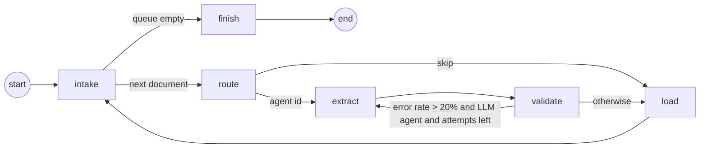

# Orchestration

**Pattern:** a supervisor/router in front of a per-document sequential pipeline with a
validation-driven retry loop, implemented as a LangGraph `StateGraph`
([`agri/orchestrator/graph.py`](../agri/orchestrator/graph.py)).



| Node | Does | Decided by |
|---|---|---|
| intake | pops the next document, opens an `extraction_run` row and a trace | rule |
| route | `router_agent`: manifest group for known files; fingerprint + LLM for unseen files | rule / **model** |
| extract | runs the chosen agent; a crash is caught and recorded as `failed` without stopping the batch | agent (mixed) |
| validate | validator agent: schema, range, unit, cross-checks; computes error rate and feedback | rule |
| load | inserts accepted rows (dedup), rejected rows, text facts, page chunks; closes the run | rule |
| finish | returns per-document summaries (written to `logs/batch_*.json`) | rule |

## How execution starts and agents are selected

* **Start:** `python scripts/run_pipeline.py` builds the queue from the manifest (or from `--docs` / `--files`).
* **Unseen files:** they are first registered as `U##` documents. Registration computes the checksum, page count, languages and Kruti Dev detection.
* **Agent selection:** routing happens per document. For known files the route is the manifest `source_group` (rule). For unseen files:
  1. `fingerprint_document` (tool) produces the facts the model sees.
  2. `llm_route` (model) picks one registered agent.
  3. If the reply is not a valid agent id, `heuristic_route` (rule) decides.
  4. With `--force-llm-routing` every file goes through the model; this is how routing accuracy is evaluated.

## How outputs and status pass between agents

The graph state carries only plain data:
* the document row
* `agent_id` and `routed_by`
* `attempt`
* a summary of the agent result (status, counts, notes, unresolved labels)
* the validation summary (error rate, top errors, feedback text)

Records, the tracer and the normalizer cache live in a side store keyed by `run_id`, so the state stays small and serialisable. The validator mutates records in place (warning notes, dedup keys), and `load` reads the validated set.

## Dependencies, retries and failures

* Inside a document the pipeline is ordered: route → extract → validate → load.
* Documents are independent of each other. Order matters only for the alias table, where verified LLM resolutions are cached for later documents.
* There are three levels of retry:
  1. *Inside a tool:* LLM answers are checked (valid ids, JSON, groundedness). A rejected answer is retried once with the error list appended to the prompt.
  2. *Inside an agent:* a deterministic fallback runs when the model still fails. Examples: the teacher extractor for island profiles, the heuristic router, and skipping unmapped columns rather than guessing.
  3. *Across the graph:* if more than 20% of an LLM agent's records are rejected by the validator, the graph re-runs `extract` with the validator's feedback (up to `MAX_RETRIES=2`).
* An agent exception is caught in `extract`. Its traceback goes into the trace, and the run is marked `failed`.
* Documents with nothing extractable end as `needs_review` (e.g. D14 without the LLM). Partial coverage ends as `partial`, with the reason in `extraction_run.error`.

## How the system knows processing is complete

The graph ends when the queue is empty. Every document then has exactly one `extraction_run` row with a terminal status (`loaded`, `partial`, `failed`, `needs_review`, `skipped`), a `finished_at` timestamp and a trace file. `scripts/eval_agents.py` reports a document that is still `running` as incomplete.

## Alternatives considered

| Alternative | Why not here |
|---|---|
| Plain sequential pipeline (one script) | Cannot branch per format, so every file would pay for every step, and retries would be ad hoc |
| Hierarchical multi-agent (agents delegating to sub-agents, LLM-planned) | Our documents need one reading strategy each. LLM planning adds calls and non-determinism without new capability, and a 3B local model is a weak planner |
| Fully LLM tool-calling agent (ReAct over all tools) | Measured: the base 3B model already invents metric names and evidence (see evaluation). A free-form loop over 20k cells would be slow and ungrounded. We use the model only where it adds understanding (header semantics, prose extraction, routing unknown files) and keep bulk cell work in code |
| Parallel workers | A single local MLX model serialises generation. Rule-only runs take ~36 s for the whole corpus, so parallelism is not the bottleneck |

## Representative multi-agent workflow (demo)

```bash
python scripts/run_pipeline.py --docs D07 D10 D13 D16
python scripts/show_trace.py D07
python scripts/show_trace.py D10 --records 5
```

The demo shows four routes, then four specialist agents with different tools. Along the way you see:
* D07: a rotated-header column sent to the LLM.
* D10: island extraction checked by the groundedness gate.
* D13: raster ruling-line detection.
* D16: OCR with a derived cell.
* The normalizer resolving "Kamorta" → `ZN_NANCOWRY` and "C/Bay" → `ZN_CAMPBELLBAY`.
* The validator's cross-checks.
* Load and completion status.
