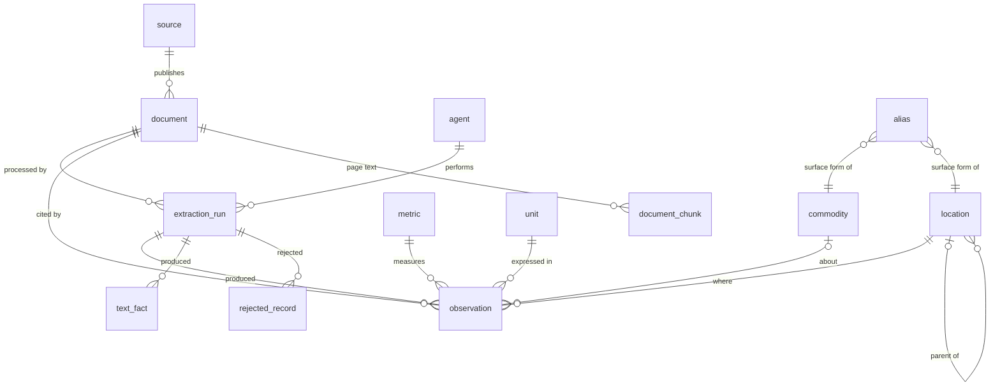

# Database schema and data dictionary

Physical store: **SQLite**, one file (`db/34_AN_knowledgebase_v1.sqlite`), DDL in
[`agri/db/schema.sql`](../agri/db/schema.sql). SQLite was chosen over MongoDB/Postgres for Phase 2
because the submission must be reproducible from one file with no server. The model is
relational, so moving to Postgres/PostGIS for Phase 3 spatial queries changes no table.

## 1. Design in one paragraph

The data really is *many numbers, each about a (thing, place, time, measure)*, printed in very
different layouts. So every extracted number is stored once, as one row in a **fact table
(`observation`)**. Its foreign keys point to **lookup tables** for what it is about (`commodity`,
`location`, `metric`, `unit`) and to **provenance** (`document` → `source`, `extraction_run` → `agent`,
plus page / table / row label / column label / raw cell text). The team's proposed *Production*,
*Price* and *Source* entities are kept: Source becomes `source` + `document`, and Production and Price
become the views `v_production` and `v_price` over `observation`. So the original logical schema
still answers its queries, and new sources (island profiles, census, LULC, budgets) did not need new tables.



## 2. How the schema meets the Phase 2 minimum

| Required | Where |
|---|---|
| Source and source type | `observation.document_id` → `document.source_id` → `source.source_type`, plus `document.modality`, `document.languages` |
| Extracting agent and run | `observation.agent_id`, `observation.run_id` → `extraction_run` (model, adapter, attempts, status, trace file) |
| Source location (page/table/URL/record id) | `observation.page`, `table_ref`, `row_label`, `col_label`, `value_raw`; `document.document_url`, `sha256` |
| Crop, location, time, units | `commodity_id`, `location_id` (hierarchy UT → district → tehsil/zone → island), `period_label` + `period_start/end` + `period_type`, `unit_id` + `unit_raw` |

## 3. Identifiers

| Entity | Key | Convention |
|---|---|---|
| source | `source_id` | `SRC_<PUBLISHER>` |
| document | `document_id` | `D01..D20` for the manifest, `U01..` for unseen documents registered at demo time; `sha256` is UNIQUE, so the same file is never stored twice |
| extraction run | `run_id` | 12-hex random id; `batch_id` groups one orchestrator invocation |
| location | `location_id` | readable codes: `AN` (UT), `AN_NMA`/`AN_SA`/`AN_NIC` (districts), `TH_*` tehsils, `ZN_*` agriculture zones, `ISL_*` islands, `MKT_AN` market |
| commodity | `commodity_id` | snake_case crop/item (`paddy`, `black_pepper`); aggregates are prefixed `agg_` and flagged `is_aggregate` |
| metric / unit | `metric_id` / `unit_id` | snake_case (`area_cultivated`, `retail_price`; `ha`, `million_nuts`, `inr_per_kg`) |
| observation | `obs_id` + **`dedup_key`** | `dedup_key = sha1(metric, commodity, location, period, document, page, table, row, column, dims)` (UNIQUE) |

## 4. Missing values, duplicates, validation

**Missing values are never stored as 0.** `value` is NULL and `missing_reason` records why:

| printed | missing_reason |
|---|---|
| `N.A`, `NA` | `not_available` |
| `Nil` | `nil` |
| `-`, `−`, `_` | `not_applicable` |
| empty cell in a mapped column | `blank` |
| text that is not a number | `unparseable` |

A CHECK constraint requires `value IS NOT NULL OR missing_reason IS NOT NULL`. A printed `0` / `0.00` / `00` is stored as 0.

**Duplicates**
* The *same cell* extracted twice (a re-run, or a retry) collapses on `dedup_key` (`INSERT OR IGNORE`); the run records how many were skipped.
* The *same fact from different documents* is kept on purpose (e.g. 2023-24 paddy area in D01 and D05; January 2024 onion price in D12 and D13), because disagreement between sources is itself information. `v_conflict` lists pairs that differ by more than 1%.
* The *same file* registered twice is blocked by `document.sha256 UNIQUE`.

**Validation rules** (`agri/agents/validator.py`; errors go to `rejected_record`, warnings are loaded with `validation='warning'` and a note):
1. Error: metric, location, commodity and unit must exist in the reference tables.
2. Error: the period must parse and satisfy `period_start ≤ period_end`.
3. Error: a value must be ≥ 0 and within a plausible range for its metric (e.g. retail price 0.01–100,000 INR, area ≤ the UT's geographic area).
4. Warning: printed yield must equal production / area within 6%.
5. Warning: child locations (zones → district → UT) must sum to the printed parent within 2%.
6. Warning: counts must be integers.
7. Agent-level checks that also write warnings:
   * The price agent compares each price against the printed %-variation columns.
   * The price agent compares the printed year row against the title years.
   * The OCR agent compares holder-type sums against the printed total.
   * The island and narrative agents apply the groundedness gate to model output.

## 5. Mapping an agent output into the schema (real example from the database)

The matrix table agent reads D02 page 1, table `p1_t0`, row "Coconut *", column "A&N Islands | Prod.":

```json
{"metric_id": "production", "commodity_id": "coconut", "location_id": "AN",
 "period_label": "2025-26", "period_type": "agri_year", "period_start": "2025-07-01", "period_end": "2026-06-30",
 "value": 118.616, "unit_id": "million_nuts", "value_raw": "118.616",
 "document_id": "D02", "page": 1, "table_ref": "p1_t0", "row_label": "Coconut *",
 "col_label": "A&N Islands | Prod.", "agent_id": "matrix_table_agent", "run_id": "<run>",
 "confidence": 1.0, "validation": "ok"}
```

Each decision in that row:
* `col_label` was split by code into "A&N Islands" (location alias → `AN`) and "Prod." (metric alias → `production`).
* The period came from the table title.
* The unit `million_nuts` comes from the footnote rule for coconut ("Production of coconut in milion nuts").

Query Q5 in [`sample_queries.md`](sample_queries.md) traces this number back to file, publisher, page and cell.

## 6. Data dictionary

### source
| column | type | meaning |
|---|---|---|
| source_id | TEXT PK | publisher id |
| name | TEXT | publisher name |
| portal_url | TEXT | official portal |
| source_type | TEXT | government_statistical_publication, geoportal, government_report, … |
| license | TEXT | licence/terms as found; unclear terms are flagged *academic use only* |

### document
| column | type | meaning |
|---|---|---|
| document_id | TEXT PK | D01–D20 / U01… |
| source_id | TEXT FK | → source |
| file_name, relative_path | TEXT | file in the corpus |
| document_url | TEXT | original URL (from the Phase 1 inventory) |
| source_group | TEXT | G1–G8, routing key |
| period_label | TEXT | period the file covers |
| modality | TEXT | pdf_digital, pdf_mixed, pdf_scanned, image |
| languages, scripts | TEXT | e.g. `en+hi`, `Latin+Devanagari (Kruti Dev legacy encoding)` |
| legacy_font | INT | 1 if the Hindi text layer is Kruti Dev |
| pages | INT | page count |
| sha256 | TEXT UNIQUE | file checksum |
| collection_date | TEXT | collection date |
| license | TEXT | licence |

### agent / extraction_run
| column | meaning |
|---|---|
| agent.agent_id, description, version | registered agents (router, 7 extractors, normalizer, validator) |
| run_id, batch_id | one document processed once, inside one batch |
| document_id, agent_id | what was processed, by whom |
| model_name, adapter | base LLM and LoRA adapter (NULL = rules only) |
| started_at, finished_at | timestamps |
| status | `loaded` \| `partial` \| `failed` \| `needs_review` \| `skipped` |
| attempts | 1 + retries triggered by the validator |
| n_extracted, n_loaded, n_rejected | record counts |
| n_llm_calls | model calls made in the run |
| manual_interventions | always 0 in automated runs; non-zero only when a human corrects a run |
| trace_path | JSONL trace of every decision and tool call |
| error | notes and errors |

### location
| column | meaning |
|---|---|
| location_id | see identifiers |
| name, name_hi | English and Hindi names |
| level | `country`, `ut`, `district`, `tehsil`, `agri_zone`, `island`, `market` |
| parent_id | hierarchy (zone → district, island → tehsil or district) |
| lgd_code | Local Government Directory code (to be filled for Phase 3) |
| area_sq_km | reserved |

### commodity
| column | meaning |
|---|---|
| commodity_id, name | id and name |
| name_hi | Hindi name, filled automatically from decoded Kruti Dev labels |
| category | cereal, pulse, oilseed, spice, plantation, fruit, vegetable, root_crop, flower, sugar, livestock_product, fish, processed_food, aggregate |
| is_aggregate | 1 for totals such as "Pulses (total)" |

### metric / unit / alias
| column | meaning |
|---|---|
| metric.metric_id, name, domain, default_unit, description | 43 metrics across production, price, inputs, infrastructure, land use, census, finance, demography |
| unit.unit_id, symbol, dimension, base_unit_id, to_base_factor | `value_in_base = value × to_base_factor` (e.g. `sq_km` → `ha` × 100) |
| alias.alias, entity_type, entity_id, lang, origin | every printed surface form; `origin` is `seed`, `llm` (verified model resolution) or `kruti_decode` |

### observation (fact table)
| column | meaning |
|---|---|
| metric_id, commodity_id, location_id | what / about what / where |
| period_label, period_type, period_start, period_end | when. `agri_year` runs Jul–Jun, `fiscal_year` Apr–Mar, `month` is a calendar month, `census_round` is the census year |
| season | kharif/rabi when printed |
| dims (JSON) | extra qualifiers: `size_class`, `holder_type`, `channel`, `variety`, `series`, `lulc_l1/l2`, `scheme`, `qualifier`, `item`, `group` |
| value, unit_id | number in the unit printed (no silent conversion) |
| value_raw, unit_raw | exact printed text |
| missing_reason | see section 4 |
| is_total_row | row or column is itself an aggregate |
| document_id, page, table_ref, row_label, col_label | provenance down to the cell |
| run_id, agent_id | which run and agent |
| confidence | 1.0 rule path; 0.8–0.9 model path; OCR confidence for images; 0.5 for derived cells |
| validation, validation_note | `ok` / `warning` / `error` and why |
| dedup_key | uniqueness |

### text_fact, document_chunk, rejected_record
| column | meaning |
|---|---|
| text_fact.subject, predicate, object, evidence, page | typed facts from narrative documents with the verbatim supporting sentence |
| document_chunk.document_id, page, text | page text (Kruti Dev decoded), used for provenance look-ups and Phase 3 retrieval |
| rejected_record.run_id, payload, reason | every record the validator refused |

### Views
| view | purpose |
|---|---|
| v_production | team's Production entity (crop, location, year, area, production, yield, source) |
| v_price | team's Price entity (commodity, market, period, retail/wholesale/farm-harvest price, unit, source) |
| v_conflict | same fact, different documents, values differ by more than 1% |
| v_provenance | each number with file, publisher, page, table, row, column, run, agent, model, adapter |
